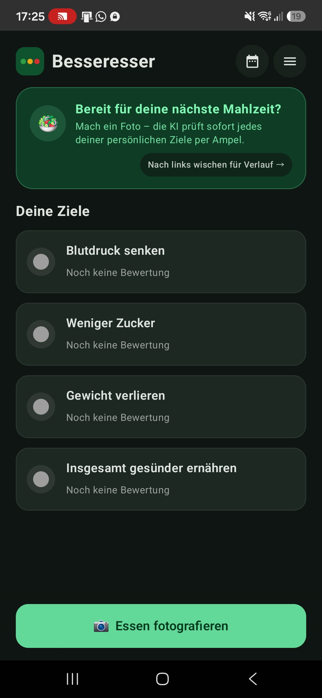
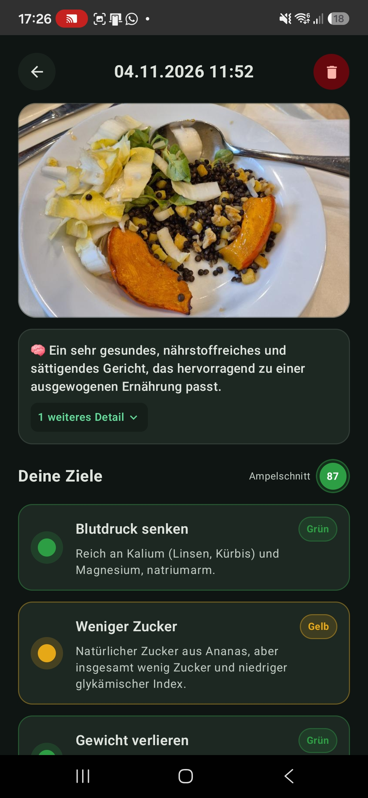
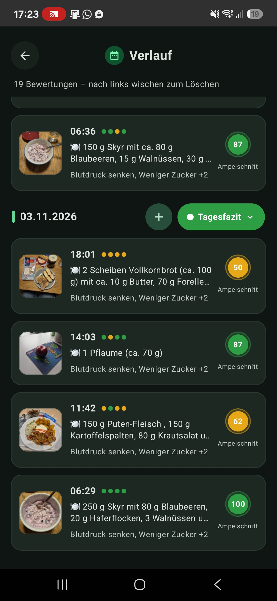
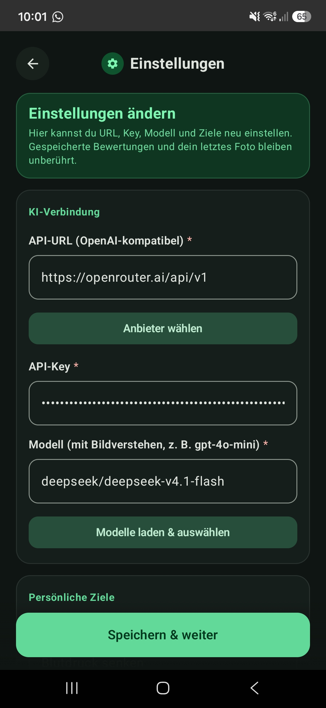

# 🥗 Besseresser

**No calorie counting. No endless food databases. Just snap a photo and immediately see how well your meal fits your personal goals.**

**Besseresser** is your personal AI nutrition companion for Android. Define what matters to you once – such as *"Lower blood pressure"*, *"Less sugar"*, *"Lose weight"*, or *"More protein"* –, take a photo of your plate, and get an honest **traffic-light rating (🟢 Green · 🟡 Yellow · 🔴 Red)** for each individual goal within seconds.

🌍 **Available in English and German** – both the app interface and the AI evaluations/summaries automatically adapt to your language (on Android 13+, you can also switch the app language independently in system settings).

---

## 📸 Screenshots

| Home & Goals | Meal Evaluation | History & Daily Summary | AI & Goal Settings |
| :---: | :---: | :---: | :---: |
|  |  |  |  |

---

## ✨ Why Besseresser?

- **🎯 Your Goals, Your Rules:**
  Instead of rigid diet plans, simply write your own health or nutrition goals as free text. If you like, the AI can even split longer descriptions into concise individual goals during setup.
- **📷 Snap, Add a Note, Done:**
  Take a photo right inside the app. If something isn't obvious from the picture (e.g. *"cooked with olive oil"* or *"only ate half the portion"*), add a quick note – frequently used notes can be starred (⭐) as favorites for one-tap reuse.
- **🚦 Clear Traffic Lights Instead of Number Overload:**
  For every goal, Besseresser gives you a clear Green, Yellow, or Red rating with a short explanation, an estimated portion size of the recognized food, and an overall traffic-light score (0–100).
- **✏️ Easily Correctable Anytime:**
  Did the AI mistake tofu for feta? Tap the pencil icon to adjust the recognized dish and Besseresser will immediately re-evaluate the meal for you.
- **📅 Balanced Daily & Weekly Summaries:**
  A single piece of chocolate doesn't ruin an otherwise healthy day. In the evening (or anytime on tap), Besseresser creates a balanced **daily summary** across all your meals – plus a **weekly summary** on Sundays.
- **➕ Log Retroactively & Duplicate Favorites:**
  Forgot to take a photo? Tap the **"+"** button on any day to log a meal retroactively – with a photo or by text description alone. Recurring meals (like your go-to breakfast) can be **duplicated** from the detail view to any calendar date in two taps.
- **👤 Optional Personal Profile:**
  Optionally add your age, weight, height, or health notes (e.g. diabetes, intolerances, medication). These details are automatically factored into your daily and weekly summaries.
- **🌐 Bilingual (German & English) + Light & Dark Mode:**
  Full support for **German** and **English**, complete with a custom emerald/sage design for both Light and Dark Mode.
- **🔒 Full Privacy & Control (Bring Your Own AI):**
  No subscription lock-in, no third-party cloud account: all your meals, photos, goals, and profile data stay **locally on your device**. Your API key is encrypted using the hardware-backed Android Keystore.

---

## 🚀 Up and Running in 2 Minutes

1. **Set Up:** On first launch, enter your personal goals and pick your preferred AI provider.
2. **Connect an AI Provider:** Besseresser works with almost any OpenAI-compatible service – quick presets are built right in:
   - **Google Gemini** *(offers a free tier)*
   - **OpenRouter** *(access hundreds of models with a single account)*
   - **OpenAI**, **Mistral**, **Groq**, **xAI (Grok)**, **Anthropic**, and more
   - Tap *"Load and pick models"* to automatically list all vision-capable models from your provider.
3. **Start Snapping:** Photograph your meal, check your traffic lights, and save it to your history!

---

## 📦 Installation & Build

You can install the app onto your Android phone (Android 8.0 / API 26 or newer) directly from source using Android Studio or the command line:

```bash
./gradlew installDebug
```

---

## 📄 License

Released under the [GNU General Public License v3.0 (GPL-3.0)](LICENSE).
